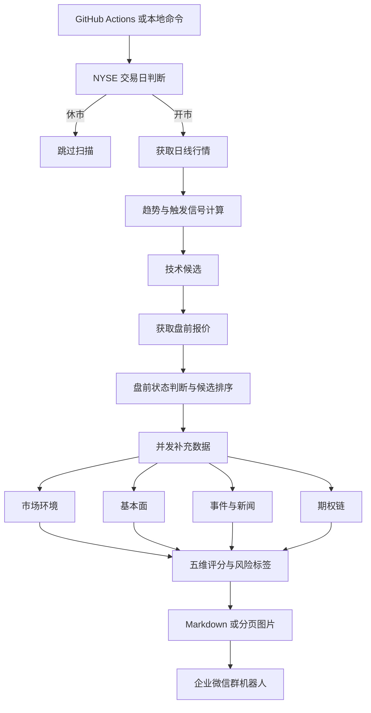

# 美股盘前趋势扫描器项目设计文档

## 1. 文档目的

本文档描述 `us-option-trend-scanner` 当前已上线版本的完整设计，包括业务目标、系统边界、总体架构、技术筛选、五维评分、风险标签、数据源、容错机制、报告生成、企业微信推送、GitHub Actions 调度、测试策略和运维方式。

项目面向个人盘前研究：每天在美股开盘前扫描固定观察池，先用日线趋势和价格行为找出技术候选，再补充市场、基本面、事件消息和期权可交易性信息，最终向企业微信群发送适合手机阅读的图片报告。

系统只提供研究信息，不自动下单，不选择具体期权合约，也不把观察分解释为胜率或涨跌预测。

## 2. 项目目标与边界

### 2.1 核心目标

- 在美股交易日开盘前自动扫描固定标的池。
- 使用上一完整交易日的数据识别顺日线趋势的技术机会。
- 使用盘前报价判断信号是否仍然有效以及是否出现过度跳空。
- 对技术候选补充五维观察分、数据完整度和风险标签。
- 免费数据源异常时仍然生成并发送可用的技术报告。
- 通过企业微信群机器人发送清晰的分页图片。
- 在 GitHub Actions 云端定时运行，减少对本地电脑的依赖。

### 2.2 当前观察池

```text
SPY QQQ AAPL MSFT GOOGL AMZN NVDA META TSLA
```

观察池在 `src/market_scanner/config.py` 中集中配置。当前版本不动态选股，也不扫描全市场。

### 2.3 非目标

- 不连接券商账户，不自动交易。
- 不推荐具体期权合约或仓位大小。
- 不计算未来收益、胜率或目标价。
- 不使用大模型判断新闻情绪。
- 不将基本面、新闻或期权数据设为硬性入选条件。
- 不保证免费行情和新闻的实时性、完整性或长期字段稳定性。

## 3. 设计原则

### 3.1 技术信号决定入选

候选集合只由原有日线技术规则决定。市场环境、基本面、事件消息和期权数据只用于解释候选质量与风险，不改变候选集合，也不改变原技术排序。

### 3.2 未知不等于负面

缺失、超时、格式异常或无法验证的数值不按零分处理。对应指标通常不进入可得分分母，并在报告中显示 `--`、`不适用` 或数据暂缺标签。新闻是一个例外：如果新闻接口可访问但最近 24 小时没有通过时间与来源校验的标题，系统仍把“未发现规则命中的负面标题”视为已知干净项并获得 3 分，但新闻新鲜度项不得分。

### 3.3 风险标签独立于总分

综合观察分不能抵消重大风险。高风险、谨慎和信息标签单独展示，并按严重程度排序。

### 3.4 外部数据失败不阻断主流程

技术扫描是核心路径。补充数据采用受限并发、单提供者超时、有限重试和全局截止时间。任何补充提供者失败时，系统仍发送技术报告。

### 3.5 免费数据源可替换

外部数据提供者统一返回标准模型。评分器和报告层不直接依赖 Yahoo 的原始结构，未来可替换成付费数据源。

## 4. 总体架构



### 4.1 分层结构

| 层次 | 主要模块 | 职责 |
| --- | --- | --- |
| 配置层 | `config.py` | 标的池、技术阈值、评分阈值、超时、Webhook |
| 交易日层 | `calendar.py` | NYSE 交易日与开盘时间判断 |
| 行情层 | `massive.py`、`massive_data.py`、`data.py` | Massive 主行情与 Yahoo 自动降级 |
| 信号层 | `signals.py`、`premarket.py` | 趋势、触发、排序和盘前状态 |
| 补充数据层 | `enrichment.py`、`providers.py`、`event_news.py`、`options.py` | 并发采集和维度级降级 |
| 评分层 | `scoring.py` | 五维得分、完整度、观察分和标签 |
| 模型层 | `models.py` | 不可变领域模型和标准提供者输出 |
| 报告层 | `report.py`、`image_report.py` | Markdown、PNG 分页和企业微信发送 |
| 编排层 | `main.py` | 扫描主流程、状态和失败隔离 |
| 云端运行 | `.github/workflows/premarket-scan.yml` | 安装、测试、定时运行和真实发送 |

## 5. 核心执行流程

### 5.1 启动方式

```bash
python -m market_scanner.main --dry-run
python -m market_scanner.main --send
```

- `--dry-run`：输出 Markdown，不构造企业微信发送客户端。
- `--send`：要求环境变量 `WECOM_WEBHOOK_URL`，生成 PNG 并发送。

### 5.2 运行状态

主流程返回以下状态之一：

| 状态 | 含义 |
| --- | --- |
| `SUCCESS` | 扫描完成，报告已输出或发送 |
| `SKIPPED_MARKET_CLOSED` | 当日不是 NYSE 交易日 |
| `DATA_FAILED` | 所有标的的日线获取或信号计算均失败 |
| `DELIVERY_FAILED` | 图片生成或企业微信发送失败 |

补充数据错误单独计入 `enrichment_failure_count`，不会把成功的技术扫描改成 `DATA_FAILED`。主流程先渲染或发送报告，再返回最终状态；如果发送失败，`DELIVERY_FAILED` 会优先于原本可能返回的 `DATA_FAILED`。CLI 不打印这些状态和计数，只用退出码表示结果：成功或休市为 0，数据或发送失败为 1，配置错误为 2。

### 5.3 执行顺序

1. 根据纽约时区查询当日 NYSE 交易时段。
2. 优先获取 QQQ，再获取其他标的的完整日线数据。
3. 计算 SPY、QQQ 市场趋势状态。
4. 对每个标的计算趋势资格和技术触发。
5. 对技术候选获取盘前报价并判断盘前状态。
6. 按原有技术规则排序候选。
7. 只对候选并发获取四类补充数据。
8. 生成五维评分、完整度、观察分和风险标签。
9. dry-run 输出 Markdown；send 模式生成一张或多张图片。
10. 企业微信客户端按页顺序发送。

## 6. 技术信号设计

### 6.1 趋势资格

标的必须同时满足：

- 最新收盘价高于 MA20。
- 当前 MA20 高于 5 个交易日前的 MA20。
- 有效日线数据不少于 60 条。

### 6.2 回调转强

最近 5 个交易日内至少有一天最低价进入该日 MA20 上下 2% 区间，并且最新收盘价重新站上前一日最高价。

参考失效位取近期最低价与最新 MA20 中的较低值。

### 6.3 平台突破

- 最新收盘价突破此前 10 个交易日最高价。
- 最新成交量不低于此前 20 日平均成交量的 1.2 倍。

参考失效位取突破平台高点与 MA20 中的较低值。

### 6.4 原技术排序

候选排序使用信号阶段生成的独立 `0–4` 技术排序分，而不是五维评分中的 30 分技术结构。四个排序项分别为：收盘高于 MA50、MA20 高于 MA50、近 10 日高低点结构抬升，以及非 ETF 标的获得的 QQQ 趋势加分。候选在取得盘前报价并生成盘前状态后排序，依次比较：

1. 技术分由高到低。
2. 盘前涨跌绝对值由小到大；报价缺失时排在同分候选之后。
3. 股票代码字母顺序。

补充维度不会重新排序候选。

## 7. 盘前状态判断

| 条件 | 状态 |
| --- | --- |
| 报价缺失、过期或错误 | 数据异常 |
| 盘前价跌破 MA20 或参考失效位 | 信号失效 |
| 盘前价高于前收 3% 以上 | 跳空偏高，不追 |
| 其他情况 | 允许关注 |

盘前状态会产生独立风险标签，例如盘前信号失效、盘前跳空偏高和盘前数据异常。

## 8. 标准领域模型

补充数据统一映射为以下模型：

- `DimensionStatus`：`ok`、`partial`、`unavailable`、`not_applicable`、`error`。
- `Evidence`：指标键、原始值、显示值、来源和采集时间。
- `ProviderResult`：维度状态、证据和风险标签。
- `EnrichmentBundle`：四类补充维度的组合。
- `DimensionScore`：维度已得分、可得分、状态和证据。
- `RiskTag`：级别、代码、标题和具体说明。
- `CandidateAssessment`：候选、总得分、完整度、观察分、分项和标签。

模型使用不可变 dataclass，降低并发处理和报告生成中的意外修改风险。

## 9. 五维评分

### 9.1 技术结构 30 分

| 指标 | 分值 |
| --- | ---: |
| 趋势资格 | 8 |
| 收盘价高于 MA50 | 4 |
| MA20 高于 MA50 | 4 |
| 近 10 日高低点结构抬升 | 4 |
| 回调转强触发 | 5 |
| 平台突破触发 | 5 |

### 9.2 市场环境 20 分

| 指标 | 分值 |
| --- | ---: |
| SPY 趋势合格 | 5 |
| QQQ 趋势合格 | 5 |
| 20 日收益相对 SPY 为正 | 4 |
| 20 日收益相对 QQQ 为正 | 3 |
| 实现波动率未处于自身极端区间 | 3 |

缺少某个基准时保留其余已知证据，维度状态为 `partial`，不会丢弃整个市场维度。

### 9.3 基本面质量 20 分

| 指标 | 分值 |
| --- | ---: |
| 营收同比增长为正 | 5 |
| 净利润同比增长为正 | 5 |
| 自由现金流为正 | 4 |
| 净利润率为正 | 3 |
| 负债权益比不超过阈值 | 3 |

优先使用最近季度与约一年前对应季度比较；季度数据不足时回退到年度数据。非数值、无穷值、NaN 和非正基期不会被当作有效增长率。SPY、QQQ 的基本面状态为 `not_applicable`。

### 9.4 事件消息风险清洁度 15 分

| 指标 | 分值 |
| --- | ---: |
| 财报距离超过 7 天 | 6 |
| 当日无已知高影响宏观事件 | 4 |
| 最近 24 小时无规则命中的负面标题 | 3 |
| 新闻来源和发布时间可识别 | 2 |

新闻只使用最近 24 小时内、具备来源和发布时间的标题。负面判断使用保守关键词，不进行大模型推断。过去的财报日期不会被当作未来事件。如果没有标题通过校验，负面标题项获得 3 分，新闻新鲜度项获得 0 分，因此事件消息维度仍有 5 分可得分进入完整度分母。

### 9.5 期权可交易性 15 分

| 指标 | 分值 |
| --- | ---: |
| 存在 14 至 45 天合适到期日 | 3 |
| 较差一侧价差率不超过 10% | 4 |
| 较差一侧未平仓量至少 500 | 3 |
| 较差一侧成交量至少 100 | 2 |
| Call 和 Put 当前 IV 均有效 | 3 |

系统选择最近的合适到期日，并分别选择最接近平值的 Call 和 Put。价差率为：

```text
(ask - bid) / ((ask + bid) / 2)
```

买卖报价必须为有限正数，且 `bid <= ask`。报价缺失或交叉时产生高风险标签。成交量、未平仓量或 IV 缺失时保留为未知，不按零处理。当前版本不计算 IV Rank。

## 10. 总分与数据完整度

### 10.1 计算公式

```text
已得分 = 所有已知指标获得的分数之和
可得分 = 所有已知指标对应的满分之和
数据完整度 = 可得分 / 适用总分
归一化观察分 = round(100 × 已得分 / 可得分)
```

- 普通股票适用总分为 100。
- SPY、QQQ 不适用基本面，适用总分为 80。
- 只有完整度达到 70% 才显示归一化观察分。
- 缺失维度不进入可得分分母。
- 观察分只描述当前可用信息，不代表概率、胜率或收益预测。

## 11. 风险标签

### 11.1 高风险

- 3 天内财报。
- 重大宏观事件日。
- 盘前信号失效。
- 盘前数据异常。
- 期权无有效报价。

### 11.2 谨慎

- 盘前跳空偏高。
- 期权价差超过 15%。
- 期权流动性偏低。
- 波动率处于异常高分位。
- 最近 24 小时存在规则命中的负面标题。
- 本地宏观日历覆盖已过期。

### 11.3 信息

- 市场环境数据暂缺。
- 基本面数据暂缺。
- 消息数据暂缺。
- 期权数据暂缺。

标签按高风险、谨慎、信息排序，并按代码去重。报告最多优先展示三个标签，同时保留具体依据。

## 12. 数据源设计

### 12.1 Massive

配置 `MASSIVE_API_KEY` 后，系统优先使用 Massive REST API 获取：

- 复权日线 OHLCV。
- 当日盘前分钟线。
- 最近新闻标题、来源和发布时间。

所有毫秒时间戳先按 UTC 解析，再转换为 `America/New_York` 交易时区。日线继续校验是否覆盖上一完整交易日；盘前分钟线只接受当日 04:00–09:30 且不晚于当前时刻的数据。HTTP 401/403 直接降级，429、5xx 和网络异常有限重试后降级，空数据与结构异常也视为失败。API Key 只通过环境变量读取，不进入 URL、日志或异常信息。

当前套餐实测日线、分钟线、标的信息和新闻可用，但响应标记为延迟；期权快照无权限，财务接口不可用。因此基本面和期权仍由 Yahoo 提供。

### 12.2 Yahoo Finance

当前通过 `yfinance` 获取 Massive 失败后的备用行情，以及：

- 公司季度和年度财务字段。
- 财报日历和新闻标题。
- 期权到期日与期权链。

Yahoo 免费字段可能延迟、缺失、被修订或改变结构，因此所有值在进入评分器前进行类型与有限性校验。

### 12.3 交易所日历

通过 `exchange-calendars` 使用 NYSE 日历判断交易日和开盘时间，避免仅凭工作日判断节假日。

### 12.4 宏观日历

宏观事件优先从在线结构化日历获取。在线请求失败后读取 `data/macro_events.json`。

本地文件必须包含覆盖起始日和有效截止日。当前日期不在覆盖范围内时，宏观事件值视为未知，不会错误获得“当日无事件”分数。仓库当前附带的文件为空，且只覆盖 2026-01-01，因此它是格式与降级占位文件，不是当前可用的离线事件源；在线日历不可用时，宏观维度会明确降级为未知。该相对路径也以源码检出或 editable install 为运行前提。

可通过环境变量 `MACRO_CALENDAR_URL` 替换在线地址。

## 13. 并发、超时与容错

### 13.1 并发模型

只对技术候选执行补充数据采集。默认使用 4 个队列工作线程调度四类维度。每次实际提供者调用会运行在独立守护线程中；调用超时后底层线程无法被 Python 强制取消，工作线程可能继续处理后续任务，因此“4 个工作线程”限制的是调度消费者数量，不是任何时刻仍存活的网络线程绝对上限。

### 13.2 超时层级

- 单提供者等待超时：默认 10 秒；超时后返回错误结果，但已启动的底层调用可能继续运行。
- 瞬时异常有限重试：默认重试 1 次；超时本身不重试。
- 整体补充数据截止时间：默认 60 秒。

执行器使用守护线程。全局截止时间限制主流程等待结果的时间，但不会清空或停止已经运行的底层调用；主流程会把未按时返回的维度标为错误并继续生成报告。

### 13.3 降级策略

| 故障 | 处理方式 |
| --- | --- |
| 单个提供者异常 | 对应维度标记 `error`，继续其他维度 |
| 单个指标缺失 | 维度标记 `partial`，该指标不计入分母 |
| 全部补充数据失败 | 发送原技术报告和数据暂缺标签 |
| 单候选评分异常 | 跳过该候选评估，仍发送技术候选 |
| 部分核心日线失败 | 报告列出异常标的，扫描继续 |
| 所有标的的日线获取或信号计算均失败 | 报告成功输出或发送后返回 `DATA_FAILED` |
| 图片或 Webhook 失败 | 返回 `DELIVERY_FAILED` |

错误日志和用户报告不得包含 Webhook、令牌或其他敏感配置。

## 14. 报告与企业微信

### 14.1 报告内容

顶部摘要包括：

- 交易日和纽约预计开盘时间。
- SPY、QQQ 趋势状态。
- 全局候选数量。
- 数据异常状态。

每个候选卡片包括：

- 股票代码、技术触发和盘前状态。
- 盘前价、盘前涨跌、前收、MA20 参考区间和失效位。
- 已得分、可得分、归一化观察分和数据完整度。
- 五个分项得分。
- 最多三个风险标签及具体说明。
- 一条可核对的核心证据。

### 14.2 图片分页

- 图片宽度固定为 860 像素。
- 至少存在一个五维评估时，默认每页最多 3 个候选卡片；若所有评估均失败并回退为纯技术报告，则当前实现生成单张图片。
- 所有分页保留全局候选数和核心失败摘要。
- 每张图片必须小于企业微信 2 MB 限制。
- 企业微信客户端按页顺序调用 `send_image`。分页发送没有事务能力：后续页面失败时，先前页面不会撤回。

Windows 默认使用微软雅黑；GitHub Actions 安装 Noto Sans CJK。其他系统可通过 `SCANNER_FONT_PATH` 指定中文字体。

### 14.3 Webhook 安全

Webhook 只通过环境变量 `WECOM_WEBHOOK_URL` 提供。GitHub 云端使用 Repository Secret，不写入代码、配置文件、日志或报告。

## 15. GitHub Actions 云端设计

工作流文件：`.github/workflows/premarket-scan.yml`。

### 15.1 触发方式

- 定时触发：工作日纽约时间 08:30。
- 手动触发：支持 `send=true` 或 `send=false`。

工作流触发后，程序仍使用 NYSE 日历二次判断是否为交易日，因此美股节假日不会发送报告。当前没有“必须早于开盘”的墙钟时间保护；延迟的定时任务或手动任务可能在开盘后继续发送，而盘前报价窗口只采集纽约时间 04:00 至 09:30 的数据。

### 15.2 执行步骤

1. Checkout 代码。
2. 安装 Python 3.12。
3. 安装 Noto CJK 字体。
4. 安装项目和测试依赖。
5. 运行完整 pytest。
6. 定时任务或 `send=true` 时注入 `MASSIVE_API_KEY` 与 `WECOM_WEBHOOK_URL` 并执行真实发送。
7. `send=false` 时执行 dry-run。

工作流超时为 15 分钟。GitHub 定时任务可能排队延迟，因此系统定位是盘前研究提醒，不是低延迟自动交易基础设施。

## 16. 配置项

主要配置位于 `Settings`：

| 配置 | 默认值 | 含义 |
| --- | ---: | --- |
| `ma_short` | 20 | 短期均线窗口 |
| `ma_long` | 50 | 长期均线窗口 |
| `slope_lookback` | 5 | MA20 斜率和回调窗口 |
| `breakout_lookback` | 10 | 平台突破窗口 |
| `pullback_band` | 0.02 | MA20 回调带宽 |
| `breakout_volume_ratio` | 1.2 | 突破放量倍数 |
| `gap_limit` | 0.03 | 盘前不追阈值 |
| `quote_stale_minutes` | 15 | 盘前报价最大允许陈旧时间 |
| `earnings_warning_days` | 3 | 财报高风险天数 |
| `option_expiry_min_days` | 14 | 最短期权到期天数 |
| `option_expiry_max_days` | 45 | 最长期权到期天数 |
| `option_max_spread_ratio` | 0.10 | 期权价差得分阈值 |
| `option_min_volume` | 100 | 最低成交量 |
| `option_min_open_interest` | 500 | 最低未平仓量 |
| `provider_timeout_seconds` | 10 | 单提供者超时 |
| `provider_retries` | 1 | 瞬时错误重试次数 |
| `enrichment_timeout_seconds` | 60 | 补充数据总截止时间 |
| `enrichment_workers` | 4 | 最大并发工作线程 |
| `normalized_score_min_completeness` | 0.70 | 显示观察分的最低完整度 |

敏感配置 `MASSIVE_API_KEY` 与 `WECOM_WEBHOOK_URL` 只从环境变量读取；可用 `MASSIVE_BASE_URL` 覆盖 Massive API 基础地址以便测试或代理接入。

## 17. 测试策略

项目使用 pytest，测试文件与模块一一对应。

### 17.1 主要测试范围

- NYSE 交易日和休市跳过。
- 日线信号、回调转强、平台突破和失效位。
- 盘前报价正常、陈旧、缺失和异常。
- 技术候选集合与排序不受补充维度影响。
- 提供者正常、部分缺失、异常、超时和重试。
- 缺少单个基准时保留部分市场证据。
- 季度同比、年度回退和非法财务字段。
- 新闻 24 小时过滤、来源校验和宏观日历过期。
- 期权到期日、平值合约、价差、流动性和 IV。
- 缺失数据不按零分、完整度阈值和 ETF 不适用分母。
- 风险标签严重程度、去重和缺失标签。
- Markdown 和 PNG 内容、中文字体、分页和 2 MB 限制。
- 评分异常和全部补充数据失败时仍发送技术报告。
- GitHub Actions 工作流结构和 Secret 使用。

### 17.2 当前验收基线

```bash
python -m pytest -q
```

当前主分支基线为 90 项测试通过。2026-11-20 的 [GitHub Actions 运行 #44655944359](https://github.com/ant2046/us-option-trend-scanner/actions/runs/44655944359) 完成了依赖安装、全量测试和 `send=true` 步骤；Actions 证明 Webhook 请求步骤成功，不等同于对企业微信客户端最终展示效果的自动验收。

## 18. 目录结构

```text
us-option-trend-scanner/
├─ .github/workflows/
│  └─ premarket-scan.yml
├─ data/
│  └─ macro_events.json
├─ docs/
│  ├─ PROJECT_DESIGN.md
│  └─ superpowers/
├─ src/market_scanner/
│  ├─ calendar.py
│  ├─ config.py
│  ├─ data.py
│  ├─ enrichment.py
│  ├─ event_news.py
│  ├─ image_report.py
│  ├─ massive.py
│  ├─ massive_data.py
│  ├─ main.py
│  ├─ models.py
│  ├─ options.py
│  ├─ premarket.py
│  ├─ providers.py
│  ├─ report.py
│  ├─ scoring.py
│  └─ signals.py
├─ tests/
├─ pyproject.toml
└─ README.md
```

## 19. 本地开发与运维

### 19.1 初始化

```bash
python -m venv .venv
# PowerShell
.\.venv\Scripts\Activate.ps1
python -m pip install -e ".[test]"
python -m pytest -q
```

项目要求 Python 3.11 或更高版本。Linux/macOS 使用 `source .venv/bin/activate` 激活环境，也可以不激活而显式调用虚拟环境中的 Python。

### 19.2 dry-run

```bash
python -m market_scanner.main --dry-run
```

### 19.3 本地真实发送

```powershell
$env:WECOM_WEBHOOK_URL="https://qyapi.weixin.qq.com/cgi-bin/webhook/send?key=..."
python -m market_scanner.main --send
```

### 19.4 常见故障

| 现象 | 检查项 |
| --- | --- |
| `DATA_FAILED` | Massive/Yahoo 是否限流、网络是否可用、权限或字段是否变化 |
| `DELIVERY_FAILED` | Webhook Secret、机器人状态、图片大小和中文字体 |
| 消息或宏观数据暂缺 | 在线日历、新闻时间戳、本地日历覆盖范围 |
| 期权维度暂缺 | 到期日范围、买卖报价、免费期权链字段 |
| 定时任务晚到 | GitHub Actions 排队情况和运行历史 |

## 20. 已知限制与后续方向

### 20.1 已知限制

- 固定观察池无法发现池外机会。
- Massive 当前套餐行情标记为延迟，且无期权快照权限。
- Yahoo 备用数据存在延迟、缺失和字段不稳定风险。
- 新闻只做关键词匹配，不能理解复杂语义。
- 当前不具备可靠的历史 IV Rank。
- 宏观本地备用数据需要定期维护覆盖范围。
- 当前仓库自带的宏观备用文件没有现行日期覆盖，在线源失败时只提供明确降级，不提供有效事件清单。
- `enrichment_failure_count` 当前统计受影响候选数，不是提供者错误总次数。
- 同一候选若既发生提供者错误又发生评分异常，失败计数可能增加两次。
- 同次扫描内的宏观日历和部分 Yahoo 对象仍可进一步缓存。
- GitHub Actions 定时运行可能延迟。
- 当前没有开盘时间硬停止，晚到的任务可能在开盘后发送。

### 20.2 可扩展方向

- 将固定观察池改为可配置或动态股票池。
- 接入付费行情、新闻、财报和期权 API。
- 增加行业 ETF 映射和行业相对强弱。
- 使用可靠历史期权数据计算 IV Rank 和 IV Percentile。
- 增加历史回测与信号效果统计，但与实时观察分明确分离。
- 增加运行监控、失败告警和数据源健康度统计。
- 将报告结果保存到数据库，支持历史查询和复盘。

## 21. 安全与合规说明

- Webhook 和 Massive API Key 必须使用环境变量或 GitHub Secret。
- 不在错误信息、日志、测试快照或报告中输出敏感配置。
- 系统不持有券商凭据，不执行交易。
- 报告必须保留“不构成投资建议”和“不代表胜率”的说明。
- 使用者应在交易前自行核对行情、财报时间、宏观事件和合约流动性。

